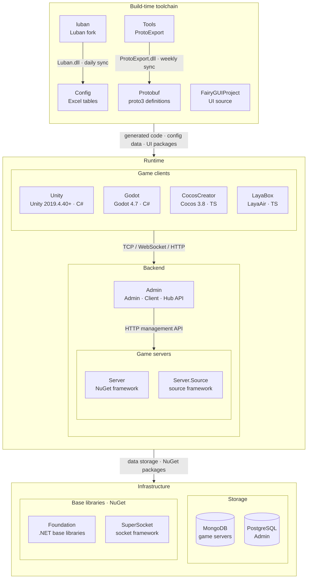

# GameFrameX

인디 게임 개발자를 위한 올인원 솔루션 · 인디 개발자의 꿈을 실현

 

[문서](https://gameframex.doc.alianblank.com) · [빠른 시작](#빠른-시작) · QQ 그룹: 467608841 / 233840761

 

[English](README.md) | [简体中文](README.zh-CN.md) | [繁體中文](README.zh-TW.md) | [日本語](README.ja.md) | **한국어**

## 프로젝트 개요

C#를 안다면 온라인 게임을 혼자서 완성할 수 있습니다. 어려운 것은 게임플레이가 아니라 그 주변의 모든 것입니다: 서버 구현, 데이터베이스 선정, 설정 테이블 파이프라인 구축, 릴리스 CI — 출시 후에는 플레이어 데이터를 볼 백오피스까지. GameFrameX는 이 모든 것을 한 번에 제공합니다: 멀티 엔진 클라이언트, 멀티 프로세스 서버, 통합 백오피스, 바로 쓸 수 있는 CI — 클라이언트와 서버는 같은 C#, 같은 Protobuf 프로토콜. 당신은 게임플레이에만 집중하세요 — 나머지는 프레임워크가 이미 조립해 두었습니다.

한 번에 전부 받아들일 필요도 없습니다. 우선 클라이언트만으로, 익숙한 엔진에서 게임플레이 프로토타입을 만드세요. 멀티플레이가 필요해지면 C# 서버를 추가하면 됩니다 — 클라이언트와 같은 언어, 같은 Protobuf 프로토콜. 출시가 다가오면 데이터베이스, 백오피스, Docker, CI가 이미 자리를 지키고 있습니다. 프레임워크는 게임과 함께 성장하여, 첫 프로토타입에서 수백만 플레이어까지 중간에 스택을 갈아탈 필요가 없습니다.

인디 개발은 혼자 싸우는 것이어서는 안 됩니다. 프레임워크는 무기이고, 문서는 지도이며, 커뮤니티는 함께 걷는 동족입니다. 한 사람에게 GameFrameX가 더해지면, 예전에 팀 전체가 가졌던 화력을 갖게 됩니다.

### 기능

- **하나의 코드베이스, 네 개의 엔진**: Unity, Cocos Creator, LayaBox, Godot 지원. 비즈니스 로직은 엔진과 분리되어 엔진을 바꾼다고 게임을 다시 만드는 것은 아닙니다. 같은 꿈이 모든 대상 플랫폼에 뿌리내립니다.
- **프로토타입부터 출시까지 버티는 멀티 프로세스 서버**: 게이트웨이, 로직, 데이터가 저마다 역할을 맡고, 플레이어가 늘면 수평으로 확장합니다. Docker 기반 빌드와 배포로 환경은 언제나 동일 — "제 로컬에서는 됐는데"는 이제 그만.
- **릴리스는 tag 하나로**: Codeup, CNB, GitHub Actions 등 주요 파이프라인은 물론, 팀이 이미 쓰고 있는 다른 CI도 그대로 연결됩니다. `tag`를 푸시하면 빌드와 배포가 알아서 돌아가고, 릴리스는 의식이 아니라 일상적인 커밋이 됩니다.
- **꺼내자마자 쓰는 데이터 스택**: 게임 데이터는 MongoDB(고병렬 읽기·쓰기 감당), 백오피스는 PostgreSQL(견고하고 안정적), 설정 테이블은 LuBan(자동 생성, 정확성 보장), 프로토콜은 Protobuf(클라이언트와 서버가 같은 메시지 정의를 공유).
- **플레이어가 보이는 통합 백오피스**: 클라이언트 관리, 운영 관리, 데이터 관리, 게임 운영. 누가 플레이하고, 무엇을 플레이하고, 어디서 막히는지 — 출시 후 데이터는 더 이상 블랙박스가 아닙니다.

## 빠른 시작

### 설치

3 분 만에 게임 서버를 실행할 수 있습니다 — 전체 단계는 [빠른 시작 가이드](https://gameframex.doc.alianblank.com)를 참고하세요.

## 사용 예시

**1인 인디 개발자** — 프로그래머, 기획자, 운영자를 한 사람이 겸합니다. 아침에는 Unity에서 게임플레이를 다듬고, 점심에는 LuBan으로 설정 테이블을 뽑고, 오후에는 `tag`를 푸시해 CI 빌드와 배포를 일으키고, 저녁에는 통합 백오피스에서 플레이어 데이터를 봅니다. 이것이 GameFrameX가 인디 개발자를 위해 준비한 일상입니다.

**소규모 팀** — 클라이언트와 서버는 같은 Protobuf 계약과 같은 데이터 맥락을 공유하고, 관리자와 개발자의 권한 경계는 명확합니다. Codeup, CNB, GitHub Actions 등 주요 파이프라인은 물론, 팀이 이미 쓰고 있는 다른 CI도 그대로 연결됩니다 — 마이그레이션 비용은 0입니다.

**이미 출시된 게임** — 프레임워크가 실제 운영을 견뎌낸 증거:

- **Animal Garden（どうぶつの花屋）** — 시뮬레이션 · 일본 App Store / 한국 Google Play
- **深夜的烧烤店（Late-Night BBQ）** — 방치형 시뮬레이션 · TapTap / App Store / Google Play
- **连续黑白（Endless Loop）** — 전략 · 출시됨
- **异次元防线（Dimensional Defense）** — 타워 디펜스 · Google Play

더 많은 예시와 튜토리얼은 [온라인 문서](https://gameframex.doc.alianblank.com)에서 확인할 수 있습니다.

## 생태계 아키텍처

GameFrameX는 아래 저장소로 구성됩니다. 빌드 시 도구 체인이 프로토콜과 설정 코드를 생성하고, 런타임에는 게임 클라이언트·게임 서버·운영 백오피스가 협력합니다.

### 핵심 프로젝트

| 프로젝트 | 역할 | 기술 스택 | 산출물 및 연동 |
|------|------|------|------|
| [Unity](https://github.com/GameFrameX/GameFrameX.Unity) | Unity 클라이언트 프로젝트: GameFrameX UPM 레지스트리에서 90개 이상의 프레임워크 패키지를 필요에 따라 조합, HybridCLR 핫 업데이트, 로그인·가방·룸 예제 포함 | Unity 2019.4.40+, HybridCLR, YooAsset, FairyGUI, UniTask | Protobuf / Config / FairyGUIProject 산출물 사용; TCP 29100 + HTTP 28080으로 Server, HTTP 20808로 Admin Client API에 연결 |
| [Server](https://github.com/GameFrameX/GameFrameX.Server) | Actor 모델 게임 서버: 영속 상태 Apps 계층과 핫 업데이트 가능한 Hotfix 로직 계층을 엄격히 분리, 단일/다중 프로세스 배포 지원 | .NET 10, MongoDB, Docker | TCP 29100 / WebSocket 29110 / HTTP 28080 수신; Admin용 메일·아이템 지급·플레이어 관리 등 HTTP 관리 API 제공 |
| [Admin](https://github.com/GameFrameX/GameFrameX.Admin) | 멀티 테넌트 운영 백오피스: Admin(20802) / Client(20808) / Hub(20806) 3개 호스트 + Vue 관리 화면, 서버 구역·공지·메일·주문 결제·원격 설정·라이브 운영 지원 | .NET 10, SqlSugar, PostgreSQL, Vue 3.5, PrimeVue | 서버 구역별 `HttpManageUrl`로 Server 호출; Client API가 게임 클라이언트에 전역 정보·로그인·결제 콜백 제공 |
| [luban](https://github.com/GameFrameX/luban) | Luban 설정 도구의 GameFrameX 포크: 공식 v5.1.0 병합, `gameframex` 테이블 임포터와 `cs-dotnet-json` / `cs-dotnet-bin` 등 생성 타깃 추가 | .NET 10, Scriban | Luban tar.gz와 Docker 이미지 배포; 매일 Config의 `Tools/`로 동기화 |
| [Config](https://github.com/GameFrameX/GameFrameX.Config) | 설정 테이블 저장소: Excel 데이터 표 + 스키마 + 현지화 표, 스크립트 한 번으로 클라이언트·서버 코드와 데이터 생성 | Excel, Luban | `gen-client-*` → Unity; `gen-server-json` → Server; `gen-server-bin` → Server.Source; `gen-godot-json` / `gen-cocos-json` / `gen-laya-json` → Godot / CocosCreator / LayaBox |
| [Protobuf](https://github.com/GameFrameX/GameFrameX.Protobuf) | 통합 네트워크 프로토콜 정의: proto3, 파일 이름의 숫자 모듈 ID별로 메시지와 오류 코드 구성(양수=클라이언트↔서버, 음수=서버 내부) | proto3 | `Proto2CsExport_Server` → Server; `Proto2CsExport_Client` → Unity; `Proto2CsExport_Godot` / `Proto2TsExport_CocosCreator` / `Proto2TsExport_LayaBox` → 기타 클라이언트; push마다 CI가 6개 언어 Release 배포 |
| [Tools](https://github.com/GameFrameX/GameFrameX.Tools) | ProtoExport 프로토콜 코드 생성기: C# / TypeScript / C++ / Lua / Go 5개 언어, CLI·Avalonia GUI·Docker 3가지 형태 제공 | .NET 10, Avalonia 12 | `ProtoExport.dll`을 매주 Protobuf의 `Tools/`로 동기화; Docker 이미지 `gameframex/gameframex-tools` |

### 주변 시스템

| 프로젝트 | 역할 | 기술 스택 | 산출물 및 연동 |
|------|------|------|------|
| [Foundation](https://github.com/GameFrameX/GameFrameX.Foundation) | 모듈형 .NET 라이브러리 모음: 현지화, JSON, 명령줄 인수, 로그, HTTP, 암호화, 해시, ORM 기본 엔티티, 멱등성 | .NET | NuGet 패키지로 Server·Server.Source·Admin·Tools에서 참조 |
| [SuperSocket](https://github.com/GameFrameX/GameFrameX.SuperSocket) | SuperSocket의 GameFrameX 포크: .NET 10 타깃, 의존성 주입, 약한 네트워크 게임 트래픽용 KCP / ReliableSession | .NET 10 | NuGet: Server(ClientEngine), Server.Source(Server / Kcp / Udp / WebSocket) |
| [Server.Source](https://github.com/GameFrameX/GameFrameX.Server.Source) | 프레임워크 계층을 저장소 내 소스로 포함한 서버 버전: 서비스 디스커버리, 프로세스 간 RemoteMessaging(TCP / KCP), 다중 프로세스 배포 | .NET 10, MongoDB, Docker | Config `gen-server-bin` 출력 대상; `docker-compose.multi.yml`로 다중 프로세스 실행 |
| [Godot](https://github.com/GameFrameX/GameFrameX.Godot) | Godot .NET 클라이언트: 재사용 가능한 런타임 모듈, 에디터 플러그인, 핫 업데이트 어셈블리 | Godot 4.7, C# | Config `gen-godot-json`, Protobuf `Proto2CsExport_Godot`; TCP 29100 / WebSocket 29110으로 Server에 연결 |
| [CocosCreator](https://github.com/GameFrameX/GameFrameX.CocosCreator) | Unity 버전을 기준으로 이식한 Cocos Creator 클라이언트 | Cocos Creator 3.8, TypeScript | `npm run gen:proto` / `gen:config`가 Protobuf / Config 스크립트 호출; WebSocket으로 Server에 연결 |
| [LayaBox](https://github.com/GameFrameX/GameFrameX.LayaBox) | LayaBox 클라이언트 | LayaAir, TypeScript | Config `gen-laya-json`, Protobuf `Proto2TsExport_LayaBox`; WebSocket으로 Server에 연결 |
| [FairyGUIProject](https://github.com/GameFrameX/GameFrameX.FairyGUIProject) | FairyGUI 에디터 프로젝트: 모든 게임 UI의 디자인 원본 | FairyGUI Editor | UI 패키지를 Unity `Assets/Bundles/UI`, 코드를 `Assets/Hotfix/UI/FairyGUI/`로 게시 |

## 의존성

이 목록을 하나씩 직접 설치·구성할 필요는 없습니다 — 데이터베이스는 `docker compose up` 한 번으로 뜨고, LuBan과 Protobuf 도구 체인은 프레임워크 워크플로에 내장되어 있습니다:

- **MongoDB** — 게임 데이터베이스: 대규모·복잡한 데이터의 빠른 읽기와 쓰기를 보장하는 고성능·유연한 스토리지 솔루션
- **PostgreSQL** — 관리용 데이터베이스: 견고하고 안정적인 관리 시스템 제공. MongoDB와 함께 다양한 비즈니스 시나리오의 요구를 충족
- **LuBan** — 데이터 테이블 도구: 테이블 처리 파이프라인을 자동화·최적화하여 정확성과 일관성 보장
- **Protobuf** — 네트워크 통신 프로토콜: 클라이언트와 서버, 서버 프로세스 간 메시지 통신에 사용되는 고속 바이너리 직렬화 방식
- **Docker** — 자동 빌드와 배포로 어떤 환경에서도 동일하게 동작

## 문서 및 자료

`모든 사이트의 내용은 동일합니다`

- 문서: https://gameframex.doc.alianblank.com
- 미러: https://gameframex-docs.pages.dev
- 미러: https://gameframex.doc.cloudflare.alianblank.com
- 미러: https://gameframex.doc.vercel.alianblank.com

## 커뮤니티 및 지원

## 변경 로그

최신 업데이트는 [온라인 문서](https://gameframex.doc.alianblank.com)를 참고하세요.

## 면책 조항

모든 플러그인은 인터넷에서 가져온 것입니다. 필요한 경우 각자 결제하여 사용하세요. 플러그인이 저작권을 침해하는 경우 이메일 또는 issue를 보내주시면 삭제하겠습니다.

본 프로젝트는 현지 법률에서 허용하지 않는 용도로 사용할 수 없습니다. 사용할 경우 본인 및 본 조직은 어떠한 법적 책임이나 약관의 구속도 인정하지 않습니다.

기술 자체는 죄가 없으며, 기술을 남용하는 사람이 잘못입니다

## 라이선스

자세한 내용은 [LICENSE.md](../LICENSE.md) 파일을 참조하세요.

<!--
EN: See [LICENSE.md](../LICENSE.md) for license information.
zh-CN: 详见 [LICENSE.md](../LICENSE.md) 文件。
zh-TW: 詳見 [LICENSE.md](../LICENSE.md) 檔案。
ja: 詳しくは [LICENSE.md](../LICENSE.md) をご参照ください。
ko: 자세한 내용은 [LICENSE.md](../LICENSE.md) 파일을 참조하세요.
-->
