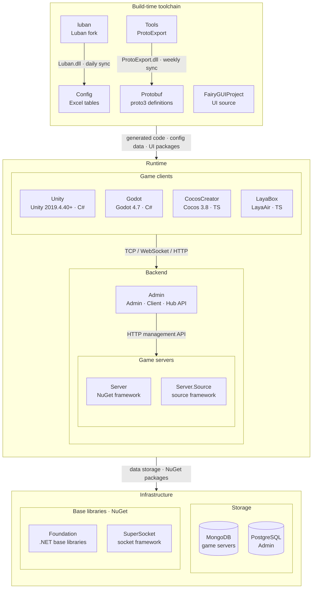

# GameFrameX

All-in-One Solution for Indie Game Development · Empowering Indie Developers' Dreams

 

[Documentation](https://gameframex.doc.alianblank.com) · [Quick Start](#quick-start) · QQ Group: 467608841 / 233840761

 

**English** | [简体中文](README.zh-CN.md) | [繁體中文](README.zh-TW.md) | [日本語](README.ja.md) | [한국어](README.ko.md)

## Project Overview

If you know C#, you can build an online game on your own. The hard part was never the gameplay — it's everything around it: writing the server, picking databases, wiring the config-table pipeline, setting up release CI, and finding a back office to watch player data after launch. GameFrameX hands you all of it at once: a multi-engine client, a multi-process server, a unified back office, and CI that works out of the box — one language, C#, across client and server, one set of Protobuf contracts. You focus on the gameplay; the framework has the rest assembled.

And you don't have to swallow it all in one bite. Start with the client alone and prototype your gameplay in the engine you already know; when you need multiplayer, add a C# server — the same language as your client, the same Protobuf contracts; when it's time to ship, the databases, back office, Docker, and CI are ready and waiting. The framework grows with your game, from the first prototype to millions of players, with no mid-journey stack swap.

Indie development should not be a lone battle: the framework is your weapon, the documentation your map, and the community your fellow travelers. One person plus GameFrameX equals the firepower that used to take a full team.

### Features

- **One codebase, four engines**: Unity, Cocos Creator, LayaBox, and Godot, with business logic decoupled from the engine. Switching engines does not mean rewriting your game — one dream lands on every target platform.
- **A multi-process server that scales from prototype to production**: gateway, logic, and data each play their part; add capacity when the players come. Docker-based build and deploy keeps every environment identical — no more "but it worked on my machine."
- **Shipping is one tag away**: Codeup, CNB, GitHub Actions, and beyond — mainstream pipelines work out of the box, and the one your team already runs plugs in just as well. Push a `tag` and the build and deployment take care of themselves; a release stops being a ritual and becomes an everyday commit.
- **A data stack that works out of the box**: MongoDB for game data, built for high-concurrency reads and writes; PostgreSQL for the back office, solid and reliable; LuBan for config tables, auto-generated and guaranteed accurate; Protobuf for the protocol, one set of message definitions shared by client and server.
- **A unified back office that shows you your players**: client management, ops management, data management, and game operations. Who is playing, what they play, where they get stuck — after launch, data is no longer a black box.

## Quick Start

### Installation

Get a game server running in three minutes — the full walkthrough is in the [Quick Start guide](https://gameframex.doc.alianblank.com).

## Usage Examples

**The solo indie developer** — one person wearing the hats of programmer, designer, and ops. Tune gameplay in Unity in the morning, pull a config table with LuBan at noon, push a `tag` in the afternoon to trigger a CI build and deploy, and watch player data on the unified back office in the evening. That is the daily routine GameFrameX prepares for indie developers.

**The small team** — client and server share the same Protobuf contracts and the same data context; permission boundaries between admins and developers stay clear; Codeup, CNB, GitHub Actions, and beyond — whatever CI the team already runs plugs right in, with zero migration cost.

**Games already live** — proof the framework holds up in real production:

- **Animal Garden (どうぶつの花屋)** — Simulation · App Store (JP) / Google Play (KR)
- **Late-Night BBQ (深夜的烧烤店)** — Idle Simulation · TapTap / App Store / Google Play
- **Endless Loop (连续黑白)** — Strategy · live in production
- **Dimensional Defense (异次元防线)** — Tower Defense · Google Play

More examples and tutorials are available in the [online documentation](https://gameframex.doc.alianblank.com).

## Ecosystem Architecture

GameFrameX consists of the repositories below: the build-time toolchain generates protocol and config code, while game clients, game servers and the operations backend cooperate at runtime.

### Core Projects

| Project | Role | Tech Stack | Integration |
|------|------|------|------|
| [Unity](https://github.com/GameFrameX/GameFrameX.Unity) | Unity client project: assembles 90+ framework packages from the GameFrameX UPM registry, HybridCLR hot update, login / bag / room samples | Unity 2019.4.40+, HybridCLR, YooAsset, FairyGUI, UniTask | Consumes Protobuf / Config / FairyGUIProject output; TCP 29100 + HTTP 28080 to Server, HTTP 20808 to Admin Client API |
| [Server](https://github.com/GameFrameX/GameFrameX.Server) | Actor-model game server: persistent Apps state layer strictly separated from the hot-updatable Hotfix logic layer; single- or multi-process deployment | .NET 10, MongoDB, Docker | Listens on TCP 29100 / WebSocket 29110 / HTTP 28080; HTTP management endpoints (mail, item grants, player management) for Admin |
| [Admin](https://github.com/GameFrameX/GameFrameX.Admin) | Multi-tenant operations backend: Admin (20802) / Client (20808) / Hub (20806) hosts + Vue console, covering game areas, announcements, mail, orders & payment, remote config, LiveOps | .NET 10, SqlSugar, PostgreSQL, Vue 3.5, PrimeVue | Calls Server through each game area's `HttpManageUrl`; Client API serves global info, login and payment callbacks to game clients |
| [luban](https://github.com/GameFrameX/luban) | GameFrameX fork of Luban: merged upstream v5.1.0, adds the `gameframex` table importer and `cs-dotnet-json` / `cs-dotnet-bin` code targets | .NET 10, Scriban | Publishes Luban tar.gz and Docker image; synced daily into Config `Tools/` |
| [Config](https://github.com/GameFrameX/GameFrameX.Config) | Config table repository: Excel data tables + schema + localization tables, one-click scripts generate client and server code and data | Excel, Luban | `gen-client-*` → Unity; `gen-server-json` → Server; `gen-server-bin` → Server.Source; `gen-godot-json` / `gen-cocos-json` / `gen-laya-json` → Godot / CocosCreator / LayaBox |
| [Protobuf](https://github.com/GameFrameX/GameFrameX.Protobuf) | Unified network protocol definitions: proto3, messages and error codes grouped by the numeric module ID in each file name (positive = client↔server, negative = server-internal) | proto3 | `Proto2CsExport_Server` → Server; `Proto2CsExport_Client` → Unity; `Proto2CsExport_Godot` / `Proto2TsExport_CocosCreator` / `Proto2TsExport_LayaBox` → other clients; CI publishes a six-language Release on every push |
| [Tools](https://github.com/GameFrameX/GameFrameX.Tools) | ProtoExport protocol code generator: C# / TypeScript / C++ / Lua / Go, available as CLI, Avalonia GUI and Docker image | .NET 10, Avalonia 12 | `ProtoExport.dll` synced weekly into Protobuf `Tools/`; Docker image `gameframex/gameframex-tools` |

### Peripheral Systems

| Project | Role | Tech Stack | Integration |
|------|------|------|------|
| [Foundation](https://github.com/GameFrameX/GameFrameX.Foundation) | Modular .NET libraries: localization, JSON, command-line options, logging, HTTP, encryption, hashing, ORM base entities, idempotency | .NET | NuGet packages referenced by Server, Server.Source, Admin, Tools |
| [SuperSocket](https://github.com/GameFrameX/GameFrameX.SuperSocket) | GameFrameX fork of SuperSocket: .NET 10 targets, dependency injection, KCP / ReliableSession for weak-network game traffic | .NET 10 | NuGet: Server (ClientEngine), Server.Source (Server / Kcp / Udp / WebSocket) |
| [Server.Source](https://github.com/GameFrameX/GameFrameX.Server.Source) | Server variant with the framework as in-repo source: service discovery, cross-process RemoteMessaging (TCP / KCP), multi-process deployment | .NET 10, MongoDB, Docker | Receives Config `gen-server-bin` output; multi-process via `docker-compose.multi.yml` |
| [Godot](https://github.com/GameFrameX/GameFrameX.Godot) | Godot .NET client with reusable runtime modules, editor plugins and hot-update assemblies | Godot 4.7, C# | Config `gen-godot-json`, Protobuf `Proto2CsExport_Godot`; TCP 29100 / WebSocket 29110 to Server |
| [CocosCreator](https://github.com/GameFrameX/GameFrameX.CocosCreator) | Cocos Creator client, migrated from the Unity version | Cocos Creator 3.8, TypeScript | `npm run gen:proto` / `gen:config` call Protobuf / Config scripts; WebSocket to Server |
| [LayaBox](https://github.com/GameFrameX/GameFrameX.LayaBox) | LayaBox client | LayaAir, TypeScript | Config `gen-laya-json`, Protobuf `Proto2TsExport_LayaBox`; WebSocket to Server |
| [FairyGUIProject](https://github.com/GameFrameX/GameFrameX.FairyGUIProject) | FairyGUI editor project: design source of all game UI | FairyGUI Editor | Publishes UI packages to Unity `Assets/Bundles/UI` and code to `Assets/Hotfix/UI/FairyGUI/` |

## Dependencies

Nothing on this list you install and wire up by hand — the databases come up with a single `docker compose up`, and the LuBan and Protobuf toolchains are built into the framework's workflow:

- **MongoDB** — the game database: a high-performance, flexible storage solution that ensures fast reads and writes for large-scale and complex data, enhancing scalability and stability
- **PostgreSQL** — the back-office database: a solid and reliable admin system; combined with MongoDB, it balances diversity and functionality to meet different business scenarios
- **LuBan** — the data table tool: automates and optimizes the table processing pipeline, greatly improving development efficiency while guaranteeing data accuracy and consistency
- **Protobuf** — the network messaging layer: efficient binary serialization for client-server and inter-process communication
- **Docker** — automated build and deployment, ensuring the software runs the same way in every environment

## Documentation & Resources

`All sites serve identical content`

- Docs: https://gameframex.doc.alianblank.com
- Mirror: https://gameframex-docs.pages.dev
- Mirror: https://gameframex.doc.cloudflare.alianblank.com
- Mirror: https://gameframex.doc.vercel.alianblank.com

## Community & Support

## Changelog

See the [online documentation](https://gameframex.doc.alianblank.com) for the latest updates.

## Disclaimer

All plugins come from the internet. Please pay for them yourself where required. If any plugin involves copyright infringement, please send an email or open an issue, and it will be removed. Thank you.

This project must not be used for purposes prohibited by local laws. If used, neither the owner nor this organization will recognize or assume any legal liability or be bound by any such terms.

Technology itself is innocent; those who abuse it are at fault.

## License

See [LICENSE.md](../LICENSE.md) for license information.

<!--
EN: See [LICENSE.md](../LICENSE.md) for license information.
zh-CN: 详见 [LICENSE.md](../LICENSE.md) 文件。
zh-TW: 詳見 [LICENSE.md](../LICENSE.md) 檔案。
ja: 詳しくは [LICENSE.md](../LICENSE.md) をご参照ください。
ko: 자세한 내용은 [LICENSE.md](../LICENSE.md) 파일을 참조하세요.
-->
