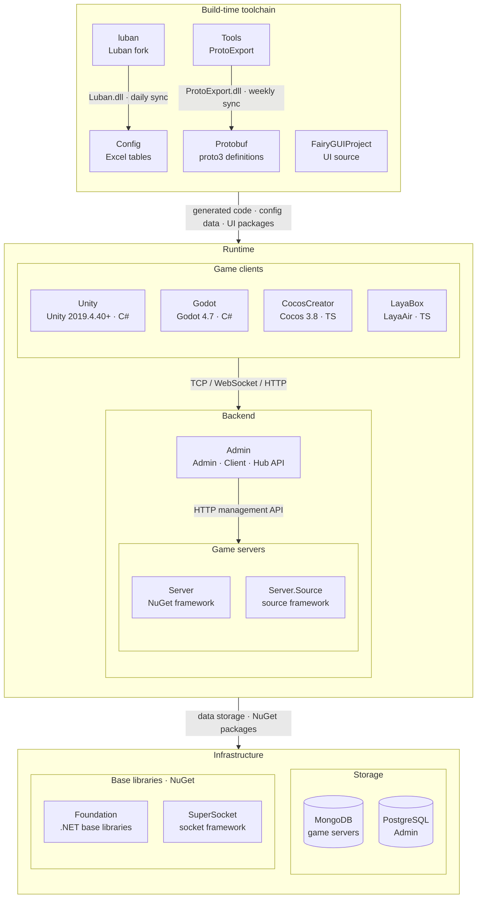

# GameFrameX

獨立遊戲前後端一體化解決方案 · 獨立遊戲開發者的圓夢大使

 

[文檔](https://gameframex.doc.alianblank.com) · [快速開始](#快速開始) · QQ群: 467608841 / 233840761

 

[English](README.md) | [简体中文](README.zh-CN.md) | **繁體中文** | [日本語](README.ja.md) | [한국어](README.ko.md)

## 項目簡介

會 C#，就能一個人做完一款連網遊戲。難的從來不是玩法，而是玩法之外的一切：寫伺服器、選資料庫、搭配置表流程、配發布 CI——上線之後，還得有後台看玩家數據。GameFrameX 把這些一次性組裝好：多引擎客戶端、多進程伺服器、一體化後台、開箱即用的 CI——前後端同一門 C#、同一套 Protobuf 協定。你只管專注玩法，剩下的框架已經備好。

不必一口吞下全家桶。先只用客戶端，在你熟悉的引擎裡把玩法原型跑起來；需要連網了，加一個 C# 伺服器——與客戶端同一門語言、同一套 Protobuf 協定；要上線了，資料庫、後台、Docker、CI 隨時在位。框架隨遊戲一起長大，從第一個原型到千萬玩家，不用中途換棧。

獨立開發不該是孤軍奮戰：框架是武器，文檔是地圖，社群是同行的族人。一個人加上 GameFrameX，就擁有過去一個團隊的火力。

### 功能特性

- **一份程式碼，四個引擎**：Unity、Cocos Creator、LayaBox、Godot 全支援，業務邏輯與引擎解耦。換引擎不等於重寫遊戲，同一個夢想在每個目標平台落地。
- **多進程伺服器，從原型扛到上線**：閘道、邏輯、數據各司其職，玩家多了就橫向擴容。Docker 自動構建部署，環境一致——不再有「我本地是好的」。
- **發布只需一個 tag**：Codeup、CNB、GitHub Actions 等主流流水線平台開箱即用，其他 CI 方案同樣接得進來。推 `tag` 即構建即部署，發布從一場儀式變成一次日常提交。
- **數據棧開箱即用**：MongoDB 存遊戲數據，扛得住高併發讀寫；PostgreSQL 管後台，穩固可靠；LuBan 處理配置表，自動生成、保準確；Protobuf 定協定，客戶端與伺服器共用一套訊息定義。
- **一體化後台，看得見你的玩家**：客戶端管理、維運管理、數據管理、遊戲營運。誰在玩、玩什麼、卡在哪——上線之後，數據不再是黑盒。

## 快速開始

### 安裝

三分鐘把伺服器跑起來——完整步驟見[快速開始指南](https://gameframex.doc.alianblank.com)。

## 使用範例

**單人獨立開發者**——一個人身兼程式、策劃、維運：早上在 Unity 裡調玩法，中午用 LuBan 拉一張配置表，下午推一個 `tag` 觸發 CI 構建與部署，晚上在一體化後台看玩家數據。這就是 GameFrameX 為獨立開發者準備的日常。

**小團隊協作**——客戶端與伺服器共享同一套 Protobuf 協議與同一個數據語境；管理員與開發者的權限邊界清晰；Codeup、CNB、GitHub Actions 等主流流水線開箱即用，團隊既有的其他 CI 方案同樣接得進來，零遷移成本。

**已上線的遊戲**——框架扛過真實營運的證明：

- **Animal Garden（どうぶつの花屋）** — 模擬經營 · 日本 App Store / 韓國 Google Play
- **深夜的燒烤店** — 放置模擬 · TapTap / App Store / Google Play
- **連續黑白** — 策略 · 已上線
- **異次元防線** — 塔防 · Google Play

更多範例與教程請見[線上文檔](https://gameframex.doc.alianblank.com)。

## 生態架構

GameFrameX 由以下倉庫組成：建置期工具鏈產生協議與配置程式碼，執行時由遊戲用戶端、遊戲伺服器與營運後台協作。

### 核心專案

| 專案 | 作用 | 技術棧 | 產物與對接 |
|------|------|------|------|
| [Unity](https://github.com/GameFrameX/GameFrameX.Unity) | Unity 用戶端工程：從 GameFrameX UPM 源按需組裝 90+ 框架元件，HybridCLR 熱更新，內建登入、背包、房間等範例 | Unity 2019.4.40+, HybridCLR, YooAsset, FairyGUI, UniTask | 使用 Protobuf / Config / FairyGUIProject 產物；TCP 29100 + HTTP 28080 連線 Server，HTTP 20808 連線 Admin Client API |
| [Server](https://github.com/GameFrameX/GameFrameX.Server) | Actor 模型遊戲伺服器：Apps 持久化狀態層與 Hotfix 可熱更邏輯層嚴格分離，支援單程序與多程序部署 | .NET 10, MongoDB, Docker | 監聽 TCP 29100 / WebSocket 29110 / HTTP 28080；為 Admin 提供郵件、發道具、玩家管理等 HTTP 管理介面 |
| [Admin](https://github.com/GameFrameX/GameFrameX.Admin) | 多租戶營運後台：Admin（20802）/ Client（20808）/ Hub（20806）三個 host + Vue 管理端，涵蓋區服、公告、郵件、訂單支付、遠端配置、線上營運 | .NET 10, SqlSugar, PostgreSQL, Vue 3.5, PrimeVue | 依區服 `HttpManageUrl` 呼叫 Server；Client API 為遊戲用戶端提供全域資訊、登入與支付回呼 |
| [luban](https://github.com/GameFrameX/luban) | Luban 配置工具的 GameFrameX 分支：合入官方 v5.1.0，新增 `gameframex` 表匯入器與 `cs-dotnet-json` / `cs-dotnet-bin` 等產生目標 | .NET 10, Scriban | 發佈 Luban tar.gz 與 Docker 映像；每日同步至 Config 的 `Tools/` |
| [Config](https://github.com/GameFrameX/GameFrameX.Config) | 配置表倉庫：Excel 資料表 + schema + 在地化表，一鍵腳本產生前後端程式碼與資料 | Excel, Luban | `gen-client-*` → Unity; `gen-server-json` → Server; `gen-server-bin` → Server.Source; `gen-godot-json` / `gen-cocos-json` / `gen-laya-json` → Godot / CocosCreator / LayaBox |
| [Protobuf](https://github.com/GameFrameX/GameFrameX.Protobuf) | 統一網路協議定義：proto3，依檔名中的數字模組 ID 組織訊息與錯誤碼（正數為用戶端↔伺服器，負數為伺服器內部） | proto3 | `Proto2CsExport_Server` → Server; `Proto2CsExport_Client` → Unity; `Proto2CsExport_Godot` / `Proto2TsExport_CocosCreator` / `Proto2TsExport_LayaBox` → 其他用戶端；每次 push 由 CI 發佈六種語言的 Release |
| [Tools](https://github.com/GameFrameX/GameFrameX.Tools) | ProtoExport 協議程式碼產生器：C# / TypeScript / C++ / Lua / Go 五種語言，提供 CLI、Avalonia GUI 與 Docker 三種形態 | .NET 10, Avalonia 12 | `ProtoExport.dll` 每週同步至 Protobuf 的 `Tools/`；Docker 映像 `gameframex/gameframex-tools` |

### 周邊系統

| 專案 | 作用 | 技術棧 | 產物與對接 |
|------|------|------|------|
| [Foundation](https://github.com/GameFrameX/GameFrameX.Foundation) | 模組化 .NET 類別庫合集：在地化、JSON、命令列參數、日誌、HTTP、加密、雜湊、ORM 基底實體、冪等性 | .NET | 以 NuGet 套件被 Server、Server.Source、Admin、Tools 引用 |
| [SuperSocket](https://github.com/GameFrameX/GameFrameX.SuperSocket) | SuperSocket 的 GameFrameX 分支：.NET 10 建置目標、相依性注入支援、面向弱網遊戲流量的 KCP / ReliableSession | .NET 10 | NuGet：Server（ClientEngine）、Server.Source（Server / Kcp / Udp / WebSocket） |
| [Server.Source](https://github.com/GameFrameX/GameFrameX.Server.Source) | 框架層以原始碼形式放在倉庫內的伺服器版本：服務發現、跨程序 RemoteMessaging（TCP / KCP）、多程序部署 | .NET 10, MongoDB, Docker | 接收 Config `gen-server-bin` 產物；`docker-compose.multi.yml` 多程序部署 |
| [Godot](https://github.com/GameFrameX/GameFrameX.Godot) | Godot .NET 用戶端：可重用執行時模組、編輯器外掛、熱更新組件 | Godot 4.7, C# | Config `gen-godot-json`, Protobuf `Proto2CsExport_Godot`；TCP 29100 / WebSocket 29110 連線 Server |
| [CocosCreator](https://github.com/GameFrameX/GameFrameX.CocosCreator) | Cocos Creator 用戶端，以 Unity 版為基準遷移 | Cocos Creator 3.8, TypeScript | `npm run gen:proto` / `gen:config` 呼叫 Protobuf / Config 腳本；WebSocket 連線 Server |
| [LayaBox](https://github.com/GameFrameX/GameFrameX.LayaBox) | LayaBox 用戶端 | LayaAir, TypeScript | Config `gen-laya-json`, Protobuf `Proto2TsExport_LayaBox`；WebSocket 連線 Server |
| [FairyGUIProject](https://github.com/GameFrameX/GameFrameX.FairyGUIProject) | FairyGUI 編輯器工程：所有遊戲介面的設計原始檔 | FairyGUI Editor | 發佈 UI 包至 Unity `Assets/Bundles/UI`，程式碼至 `Assets/Hotfix/UI/FairyGUI/` |

## 依賴

這份清單不需要逐個安裝配置——資料庫由 Docker Compose 一鍵拉起，LuBan 與 Protobuf 工具鏈已內置在框架的開發流程裡：

- **MongoDB** — 遊戲資料庫：高效能、靈活的資料儲存方案，確保大規模和複雜資料的快速讀寫能力，增強遊戲的擴展性和穩定性
- **PostgreSQL** — 後台管理資料庫：提供穩固可靠的後端管理系統；與 MongoDB 相互配合，實現資料解決方案上多樣性和功能性的平衡，滿足不同場景下的業務需要
- **LuBan** — 數據表工具：自動化並最佳化數據表的處理流程，極大提高開發效率，並保證數據的準確性和一致性
- **Protobuf** — 網路通訊協定：高效的二進位序列化方案，用於客戶端與伺服器、伺服器進程之間的訊息通訊
- **Docker** — 自動化構建與部署，確保在不同環境下軟體以同樣的方式運行

## 文檔與資源

`所有站點內容一致，不存在內容不一致的情況`

- 文檔地址：https://gameframex.doc.alianblank.com
- 備用地址：https://gameframex-docs.pages.dev
- 備用地址：https://gameframex.doc.cloudflare.alianblank.com
- 備用地址：https://gameframex.doc.vercel.alianblank.com

## 社區與支援

## 更新日誌

最新動態請查看[線上文檔](https://gameframex.doc.alianblank.com)。

## 免責聲明

所有插件均來自互聯網，請各位使用時自行付費。如果以上插件涉及侵權，請發 email 或提交 issue，本人將移除，謝謝。

該項目不得用於當地法律不允許的使用範圍。如果使用，本人或本組織將不承認和承擔任何的法律責任和條款約束。

技術本無罪，錯的是濫用技術的人

## 開源協議

詳見 [LICENSE.md](../LICENSE.md) 檔案。

<!--
EN: See [LICENSE.md](../LICENSE.md) for license information.
zh-CN: 详见 [LICENSE.md](../LICENSE.md) 文件。
zh-TW: 詳見 [LICENSE.md](../LICENSE.md) 檔案。
ja: 詳しくは [LICENSE.md](../LICENSE.md) をご参照ください。
ko: 자세한 내용은 [LICENSE.md](../LICENSE.md) 파일을 참조하세요.
-->
